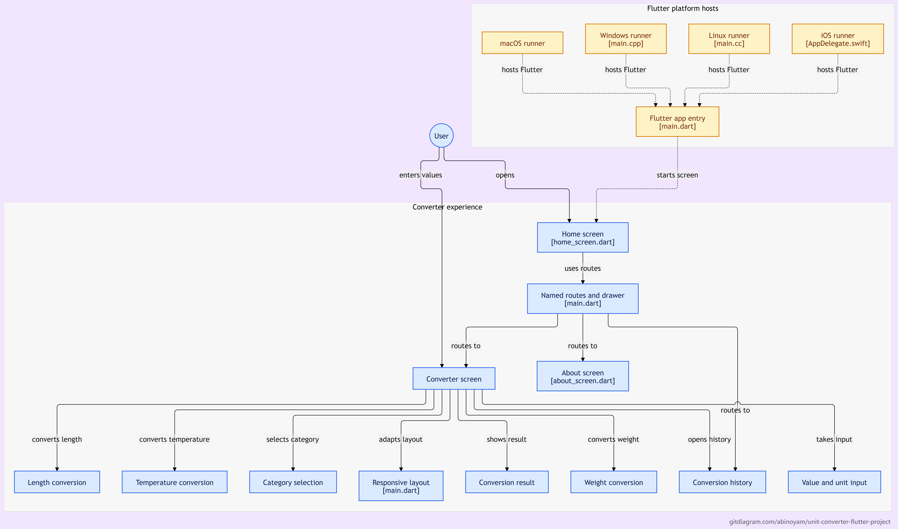

# UNIT CONVERTER FLUTTER PROJECT

## UI Design Using Flutter Lab (CS506PC)

STUDENT DETAILS :
Name: S.Abinoyam
Roll No.: 24AG1A05AN
Branch: Computer Science and Engineering
Year: III B.Tech
College: ACE Engineering College
Subject: UI Design Using Flutter Lab
Subject Code: CS506PC
Academic Year: 2026

## PROJECT TITLE :

Unit Converter Flutter Project

## ABSTRACT :

The Unit Converter Flutter Project is a mobile application developed using the Flutter framework to provide a simple, fast, and user-friendly solution for converting values between different units of measurement.

The application supports different categories of conversions such as Length, Weight, and Temperature. Users can enter a value, select the source unit, select the target unit, and instantly view the converted result.

The project demonstrates important concepts of Dart and Flutter including programming fundamentals, user input handling, widgets, layouts, state management, mathematical calculations, responsive user interface design, and navigation between different screens.

## TECHNOLOGIES USED

* Flutter
* Dart
* Visual Studio Code
* Android Studio
* Git
* GitHub

# EXPERIMENTS / STAGES

## STAGE-1 - EXPERIMENT 01

**Title: Installation of Flutter & Dart SDK and Introduction to Dart Programming**

### Aim:

1. To install Flutter SDK and Dart SDK successfully.
2. To configure the Flutter development environment.
3. To understand the basic features of Dart programming.
4. To write and execute simple Dart programs.

### Concepts Covered:

* Flutter SDK
* Dart SDK
* Flutter development environment
* Dart syntax
* Variables and data types
* Conditional statements
* Loops
* Basic Dart programming

### Programs Implemented:

1. Largest of two numbers
2. Area of a rectangle
3. Even or Odd number
4. Factorial of a number
5. Fibonacci series

**Folder: STAGE-1/**

### Result:

Flutter and Dart development environment was successfully configured and basic Dart programs were implemented and executed successfully.

## STAGE-2 - EXPERIMENT 02

**Title: Exploring Flutter Widgets and Implementing Different Layout Structures using Row, Column, and Stack Widgets**

### Aim:

1. To understand Flutter widgets.
2. To explore commonly used Flutter widgets.
3. To design user interfaces using Row, Column, and Stack.
4. To understand widget nesting and layout management.

### Concepts Covered:

* Widget Tree
* StatelessWidget
* StatefulWidget
* Text
* Icon
* Container
* ElevatedButton
* Row
* Column
* Stack
* Scaffold
* AppBar
* Widget nesting

### Project Implementation:

A basic Unit Converter application was implemented using Flutter.

The application includes:

* Unit category selection
* Value input
* From-unit selection
* To-unit selection
* Conversion button
* Result display
* Length conversion
* Weight conversion
* Temperature conversion

### Layout Widgets Used:

Column: Used to arrange the main components vertically.
Row: Used to arrange the From and To unit selection horizontally.
Stack: Used to demonstrate overlapping UI elements.

**Folder: STAGE-2/**

### Result:

Different Flutter widgets and layout structures were successfully explored and implemented in the Unit Converter application.

## STAGE-3 - EXPERIMENT 03

**Title: Design a Responsive User Interface Using MediaQuery and LayoutBuilder**

### Aim:

1. To understand responsive user interface design.
2. To design Flutter applications that adapt to different screen sizes.
3. To implement responsiveness using MediaQuery.
4. To implement responsive layouts using LayoutBuilder.

### Concepts Covered:

* Responsive UI
* MediaQuery
* LayoutBuilder
* Screen width
* Screen size
* Responsive spacing
* Responsive font size
* Responsive icon size
* Row and Column based on screen width

### Project Implementation:

The Unit Converter application was enhanced with responsive UI features.

### MediaQuery:

MediaQuery is used to obtain the screen dimensions. The application uses the available screen width to adjust UI elements according to the screen size.

### LayoutBuilder:

LayoutBuilder is used to determine the available width and change the layout accordingly.

For wider screens, the From and To unit selections are displayed horizontally using a Row.
For smaller screens, they are displayed vertically using a Column.

### Responsive Features:

* Responsive icon size
* Responsive heading size
* Responsive horizontal padding
* Responsive unit selection layout
* Screen width display
* Maximum content width
* Adaptation to different screen sizes

**Folder: STAGE-3/**

### Result:

A responsive Unit Converter user interface was successfully designed using MediaQuery and LayoutBuilder.

## STAGE-4 - EXPERIMENT 04

**Title: Navigation Between Different Screens Using Navigator and Named Routes**

### Aim:

1. To understand navigation in Flutter applications.
2. To implement navigation between multiple screens using the Navigator class.
3. To implement navigation using Named Routes.
4. To apply navigation concepts to the Unit Converter application.

### Concepts Covered:

* Flutter Navigation
* Navigator
* Navigator.push()
* Navigator.pop()
* Named Routes
* Navigator.pushNamed()
* Route management
* Multiple screens
* Navigation stack

### Project Implementation:

The Unit Converter application was enhanced with multiple screens and navigation functionality.

The application includes:

* Home Screen
* Converter Screen
* Conversion History Screen
* About Screen
* Navigation Drawer
* Navigation using Named Routes
* Back navigation using Navigator.pop()
* Navigation from Home Screen to Converter Screen
* Navigation from Converter Screen to History Screen
* Navigation to About Screen

### Screens Implemented:

**Home Screen:**
Provides the main interface of the Unit Converter application and allows the user to start the conversion process.

**Converter Screen:**
Provides the unit conversion interface where users can enter values, select categories, select source and target units, and view the converted result.

**History Screen:**
Provides a separate screen for viewing conversion history. The screen also demonstrates navigation between the converter and history sections.

**About Screen:**
Displays information about the Unit Converter application and the technologies used.

### Navigation Methods Used:

**Navigator.push():**
Used to navigate from one screen to another by adding a new screen to the navigation stack.

**Navigator.pop():**
Used to return to the previous screen.

**Named Routes:**
Named routes are defined in the MaterialApp and used to navigate between different screens.

Example routes used in the application:

* `/`
* `/converter`
* `/history`
* `/about`

**Navigator.pushNamed():**
Used to navigate to a screen using its predefined route name.

### Navigation Flow:

Home Screen
↓
Converter Screen
↓
History Screen

Home Screen
↓
About Screen

The Navigation Drawer provides access to:

* Home
* Converter
* History
* About

**Folder: STAGE-4/**


## STAGE-5 - EXPERIMENT 05

**Title: State Management and Handling User Input in Flutter**

### Aim:

1. To understand state management in Flutter.
2. To handle user input and update the user interface.
3. To use StatefulWidget and setState() to refresh displayed data.
4. To improve interaction and usability in the Unit Converter application.

### Concepts Covered:

* StatefulWidget
* State class
* setState()
* TextEditingController
* Form and input validation
* Dropdown selection
* Dynamic UI updates

### Project Implementation:

State management can be used to update the interface whenever users change input values or conversion options. The implementation details should be verified against the original STAGE-5 project.

### Result:

State management and user input handling concepts are documented for interactive Flutter UI components.

**Folder: STAGE-5/**

## STAGE-6 - EXPERIMENT 06

**Title: Custom Widgets and Light/Dark Themes in Flutter**

### Aim:

1. To understand reusable Flutter widgets.
2. To apply consistent styling using ThemeData.
3. To implement light and dark themes.
4. To improve the appearance and maintainability of the application.

### Concepts Covered:

* Custom and reusable widgets
* ThemeData
* ColorScheme
* ThemeMode
* Light theme and dark theme
* Material Design widgets
* IconButton and FilledButton

### Project Implementation:

The combined learning application includes a theme demonstration screen with a control for switching between light and dark themes. Reusable Material widgets such as cards, icons, and buttons demonstrate consistent styling.

### Result:

Reusable widgets and theme configuration were demonstrated, including switching between light and dark appearance.

**Folder: STAGE-6/**

## STAGE-7 - EXPERIMENT 07

**Title: Form Validation and Error Handling in Flutter**

### Aim:

1. To understand input validation.
2. To prevent invalid values from being processed.
3. To provide useful feedback when input is invalid.
4. To improve the reliability of the Unit Converter application.

### Concepts Covered:

* Input validation
* Numeric parsing
* Error handling
* User feedback
* SnackBar
* tryParse()
* ArgumentError

### Project Implementation:

Validation can ensure that entered values are valid numbers before conversion. Invalid input should be handled gracefully and explained to the user. Verify the final implementation against the original STAGE-7 project.

### Result:

Input validation and error-handling concepts are documented for improving the reliability of a Flutter application.

**Folder: STAGE-7/**

## STAGE-8 - EXPERIMENT 08

**Title: Implementing Animations in Flutter**

### Aim:

1. To understand animations in Flutter.
2. To add visual transitions to UI updates.
3. To use AnimatedSwitcher for changing displayed content.
4. To improve the user experience with animated results.

### Concepts Covered:

* AnimatedSwitcher
* Duration
* FadeTransition
* SlideTransition
* Tween
* Animation
* Stateful UI updates

### Project Implementation:

The combined learning application includes an animated Unit Converter screen. When the converted result changes, AnimatedSwitcher displays the updated result with fade and slide transitions.

### Result:

Animated transitions were demonstrated in the Unit Converter interface.

**Folder: STAGE-8/**

## STAGE-9 - EXPERIMENT 09

**Title: Fetching Data from a REST API in Flutter**

### Aim:

1. To understand REST APIs.
2. To send HTTP requests from a Flutter application.
3. To decode JSON responses.
4. To display data received from an external API.

### Concepts Covered:

* REST API
* HTTP GET request
* JSON decoding
* Asynchronous programming
* Future and async/await
* Loading indicators
* Error handling
* Internet permission for Android

### Project Implementation:

The combined learning application includes a weather screen that requests current weather data from the Open-Meteo API. It displays temperature, wind speed, and the returned weather code. Loading, failure, and retry states are included.

### Result:

REST API integration and JSON response handling were demonstrated using weather data from an external service.

**Folder: STAGE-9/**

## STAGE-10 - EXPERIMENT 10

**Title: Testing and Debugging a Flutter Application**

### Aim:

1. To understand unit testing and widget testing.
2. To verify the correctness of conversion calculations.
3. To test important UI elements and interactions.
4. To identify and resolve errors during development.

### Concepts Covered:

* Unit testing
* Widget testing
* flutter_test
* testWidgets()
* expect()
* Finders
* Debugging
* Test verification

### Project Implementation:

The Unit Converter logic can be tested independently with different input values and unit combinations. Widget tests can verify that the learning hub displays all ten stage entries and that converter controls produce the expected result.

### Commands Used:

```bash
flutter pub get
flutter test
flutter run
```

### Result:

Testing and debugging procedures are documented for verifying conversion logic and Flutter user interface behavior.

**Folder: STAGE-10/**

### Features Demonstrated:

* Stage selection from a single hub
* Unit conversion
* Light and dark theme demonstration
* Animated conversion result
* Weather data from a REST API
* Testable conversion screen

### Result:

Navigation between multiple screens was successfully implemented in the Unit Converter application using Navigator and Named Routes.

# LEARNING OUTCOMES

After completing these experiments, the following concepts were learned:

* Installation and configuration of Flutter and Dart.
* Basic Dart programming.
* Flutter widget structure.
* Stateless and Stateful widgets.
* Designing layouts using Row, Column, and Stack.
* Handling user input.
* Implementing unit conversion logic.
* Designing responsive Flutter interfaces.
* Using MediaQuery for screen dimensions.
* Using LayoutBuilder for adaptive layouts.
* Implementing navigation between multiple screens.
* Using Navigator for screen navigation.
* Using Navigator.push() and Navigator.pop().
* Using Named Routes for navigation.
* Designing a multi-screen Flutter application.
* Using Git for version control.
* Managing a project using GitHub.


# CONCLUSION

The Unit Converter Flutter Project demonstrates the gradual development of a Flutter application from basic Dart programming to widget-based UI design, responsive user interface development, and multi-screen navigation.

Through the four experiments, the project covers Dart fundamentals, Flutter widgets and layouts, responsive design using MediaQuery and LayoutBuilder, and navigation using Navigator and Named Routes.

The project provides practical experience in developing a Flutter application using Dart, Flutter, Git, and GitHub.

The Unit Converter application was progressively enhanced at each stage, making the project more organized, responsive, and user-friendly.

# GITHUB REPOSITORY

https://github.com/Abinoyam/Unit-Converter-Flutter-Project


## Project Architecture



